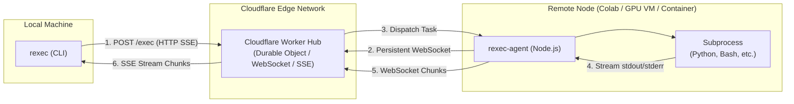

# rexec

Ultra-lightweight edge-routed remote execution engine.

`rexec` allows you to execute shell commands on any remote machine (GPU instances, Google Colab notebooks, cloud VMs, or containers) directly from your local terminal. Powered by Cloudflare Workers and Durable Objects, it routes traffic through the edge, eliminating the need for public IP addresses, inbound firewall rules, or complex reverse proxy setups.

---

## Features

- **Serverless Edge Relay**: Built on Cloudflare Workers and Durable Objects, providing global low-latency routing without maintaining self-hosted relays.
- **Zero-Dependency Remote Agent**: The target worker agent runs on standard Node.js without any third-party npm dependencies.
- **Dual Client Architecture**:
  - `rexec`: Local invoker CLI that streams real-time stdout/stderr and mirrors remote process exit codes.
  - `rexec-agent`: Remote daemon running on target worker nodes that maintains a persistent WebSocket connection and manages child process lifecycles.
- **Real-Time Streaming & Process Fidelity**: Chunked execution output streamed via WebSocket and Server-Sent Events (SSE). Clean process termination and signal forwarding on `Ctrl+C` (SIGINT).

---

## Architecture



---

## Getting Started

### 1. Install

```bash
git clone https://github.com/CyberVy/rexec.git
cd rexec
npm install
npm run build
npm link
```

### 2. Deploy the Hub (Cloudflare Workers)

Deploy the relay server directly to Cloudflare Workers with zero configuration:

```bash
# Deploy to Cloudflare Workers
npm run deploy
```

No environment variables or secrets are required at deployment time. All worker nodes are managed concurrently within a single Durable Object instance.

---

### 3. Start the Remote Agent (`rexec-agent`)

On your target machine (e.g., Google Colab, remote GPU VM, or container), run `rexec-agent`:

```bash
# Auto-generate a session token on startup
npx rexec-agent --hub https://<your-worker>.workers.dev

# Or specify a custom static token
npx rexec-agent --hub https://<your-worker>.workers.dev --token <custom-secret>
```

When started without `--token`, `rexec-agent` automatically generates a secure session token and outputs ready-to-use local execution commands:

```text
[rexec-agent] Connected to hub. Node ID: colab-gpu-01
[rexec-agent] Session Token: rexec_sec_e4b1a82f3c4d5e6f7a8b9c0d1e2f3a4b

======================================================
Session Token generated!
To run commands from your local machine, use:
  rexec --hub https://<your-worker>.workers.dev --token rexec_sec_e4b1a82f3c4d5e6f7a8b9c0d1e2f3a4b <command...>
======================================================
```

---

### 4. Run Remote Commands (`rexec`)

On your local machine, set your environment variables (e.g., in `~/.bashrc` or `~/.zshrc`):

```bash
export REXEC_HUB=https://<your-worker>.workers.dev
export REXEC_TOKEN=<your-secret-token>
```

#### Check Connection Status

```bash
rexec status
```

Example output:

```text
Hub Status: ok
Agent Connected: YES (Online)
Active Tasks: 0
```

#### Execute Commands

```bash
# Run remote command (default fallback)
rexec "nvidia-smi"

# Explicit subcommand syntax
rexec run python train.py --epochs 10 --batch-size 32

# Specify a working directory relative to the remote workspace
rexec --cwd backend "pytest tests/"

# Override execution timeout in milliseconds (default: 300000 / 5 minutes)
rexec --timeout 600000 "make build"

# Use shell pipes and complex commands
rexec "cat /proc/cpuinfo | grep 'model name' | head -n 1"

# Escape commands matching subcommands
rexec -- pull origin main
```

#### Transfer Files

```bash
# Download a file from remote agent to local directory
rexec pull loss.png

# Download to a specific local path (or directory)
rexec pull /content/loss.png ./plots/loss.png

# Overwrite existing local file
rexec pull -f model.pt ./checkpoints/best.pt

# Upload a local file to remote workspace
rexec push config.yaml

# Upload to a specific remote destination
rexec push ./dataset.zip /content/dataset.zip
```

---

## CLI Reference

### Local Invoker Client: `rexec`

```text
Usage:
  rexec [options] <command...>        Execute remote command (default fallback)
  rexec run [options] <command...>    Explicitly execute remote command
  rexec pull [options] <remote> [loc] Download a file from remote agent
  rexec push [options] <loc> [remote] Upload a file to remote agent
  rexec status [options]              Check connection and agent status
  rexec -- [options] <command...>     Escape command collisions with subcommands

Options:
  --hub <url>        Hub URL (or via REXEC_HUB env var)
  --token <secret>   Auth Token (or via REXEC_TOKEN env var)
  --cwd <dir>        Remote working directory relative to remote workspace
  --timeout <ms>     Command execution timeout in milliseconds (default: 300000)
  -f, --force        Overwrite local target file when pulling
  -h, --help         Show this help message
```

### Remote Worker Agent: `rexec-agent`

```text
Usage:
  rexec-agent [options]

Options:
  --hub <url>          Hub WebSocket/HTTP URL (or via REXEC_HUB env var)
  --token <secret>     Auth Token (or via REXEC_TOKEN env var)
  --workspace <dir>    Base workspace directory (default: current working directory)
  --node-id <id>       Worker node identifier (default: hostname)
  -h, --help           Show this help message
```

---

## Development & Testing

```bash
# Build standalone distributions (dist/rexec.mjs and dist/rexec-agent.mjs)
npm run build

# Start local black-box debug harness (Hub + Agent logging to .debug/)
npm run debug:serve

# Run automated end-to-end test matrix (in another terminal)
npm run debug:test

# Lint and typecheck
npm run format
npm run check
```

---

## License

[MIT](LICENSE)
