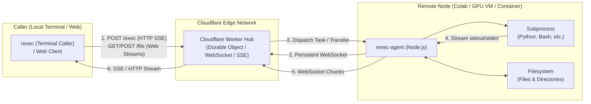

# rexec

Ultra-lightweight edge-routed remote execution engine.

`rexec` allows you to execute shell commands on any remote machine (GPU instances, Google Colab notebooks, cloud VMs, or containers) directly from your local terminal. Powered by Cloudflare Workers and Durable Objects, it routes traffic through the edge, eliminating the need for public IP addresses, inbound firewall rules, or complex reverse proxy setups.

---

## Features

- **Serverless Edge Relay**: Built on Cloudflare Workers and Durable Objects, providing global low-latency routing without maintaining self-hosted relays.
- **Zero-Dependency Runtimes**: Both the remote worker agent and local terminal caller run on standard Node.js without any third-party npm dependencies.
- **Three-Tier Architecture**:
  - **Caller** (`rexec` CLI & universal `RexecCaller` SDK): Initiates executions and file transfers using 100% Web standard APIs.
  - **Hub** (Cloudflare Worker & Durable Object): Edge routing and streaming relay between callers and worker nodes.
  - **Agent** (`rexec-agent`): Remote daemon running on target worker nodes that maintains a persistent WebSocket connection and manages child process lifecycles.
- **Real-Time Streaming & Process Fidelity**: Chunked execution output streamed via WebSocket and Server-Sent Events (SSE). Clean process termination and signal forwarding on `Ctrl+C` (SIGINT).
- **Interactive PTY**: `rexec tty` runs a remote command in a pseudoterminal and attaches your local terminal. The agent downloads the native binding on the first session.
- **Full-Duplex Port Forwarding**: Multiplexed TCP tunneling over WebSocket (`rexec forward [local_port:]remote_port`), seamlessly routing local ports to remote web services (Jupyter, Gradio, ComfyUI, TensorBoard) without public IP or inbound firewalls.
- **Streaming File & Directory Transfers**: Bi-directional file and directory transfers powered by WHATWG Web Streams and streaming `tar` pipelines with real-time transfer progress bars.

---

## Architecture



---

## Getting Started

### 1. Install Local CLI (`rexec`)

Install the `rexec` command-line tool on your local machine with a single command (requires Node.js 20+):

```bash
curl -fsSL https://rexec.edgetool.workers.dev/install/caller | bash
```

*(This automatically downloads the standalone client to `~/.local/bin/rexec` or `/usr/local/bin/rexec` and sets executable permissions).*

---

### 2. Setup the Hub (optional)

You can connect to the official public Hub directly, or deploy your own relay server to Cloudflare Workers.

- **Public Hub**:
  ```text
  https://rexec.edgetool.workers.dev
  ```
  *(Ready to use out-of-the-box — no deployment required)*

- **Self-Hosted Hub (Cloudflare Workers)**:
  Deploy your own isolated relay server with zero configuration:
  ```bash
  npm run deploy
  ```
  No environment variables or secrets are required at deployment time. Static distribution assets (`/install/*`, `/agent`, and standalone bundles) are bundled and deployed automatically.

---

### 3. Start the Remote Agent (`rexec-agent`)

On your target machine (e.g., Google Colab, remote GPU VM, or container), install and start `rexec-agent`:

#### Install `rexec-agent`

```bash
curl -fsSL https://rexec.edgetool.workers.dev/install/agent | bash
```

*(This automatically installs the standalone daemon to `~/.local/bin/rexec-agent` or `/usr/local/bin/rexec-agent`).*

#### Run the Daemon

```bash
# Auto-generate a session token on startup
rexec-agent --hub https://rexec.edgetool.workers.dev

# Or specify a custom static token
rexec-agent --hub <hub-url> --token <custom-secret>
```

The agent reconnects with the same hub, token, workspace, and node id when application pings go unanswered, or the socket sits in `CLOSING` (a proxy delivered a close frame but did not finish TCP). A local proxy can keep the process's TCP session looking open after the Hub has already dropped it. Liveness is the WebSocket pong. `GET /health` stays available for `rexec status` and other callers; the agent does not poll it.

Timers are milliseconds. `0` disables that one check. Defaults are in parentheses.

- `REXEC_HEARTBEAT_INTERVAL_MS` — application ping interval (`5000`)
- `REXEC_HEARTBEAT_TIMEOUT_MS` — reconnect if no Hub frame arrives (`15000`, or 3× the ping interval when only the interval is set)
- `REXEC_RECONNECT_DELAY_MS` — wait before the next attempt (`3000`)
- `REXEC_CONNECT_TIMEOUT_MS` — handshake deadline for every attempt (`10000`)

`rexec-agent --help` prints the same list.

When started without `--token`, `rexec-agent` automatically generates a secure session token and outputs ready-to-use local execution commands:

```text
[rexec-agent] Connected to hub. Node ID: colab-gpu-01
[rexec-agent] Session Token: rexec_sec_e4b1a82f3c4d5e6f7a8b9c0d1e2f3a4b

======================================================
Session Token generated!
To run commands from your local machine, use:
  rexec --hub <hub-url> --token rexec_sec_e4b1a82f3c4d5e6f7a8b9c0d1e2f3a4b <command...>

Or set environment variables:
  export REXEC_HUB=<hub-url>
  export REXEC_TOKEN=rexec_sec_e4b1a82f3c4d5e6f7a8b9c0d1e2f3a4b
======================================================
```

---

### 4. Run Remote Commands (`rexec`)

On your local machine, set your environment variables (e.g., in `~/.bashrc` or `~/.zshrc`):

```bash
export REXEC_HUB=<hub-url>
export REXEC_TOKEN=<your-secret-token>
```

#### Check Connection Status

```bash
rexec status
```

Example output:

```text
Hub Status: ok
Agent Connected: YES (Online)
Active Tasks: 0
```

#### Execute Commands

```bash
# Run remote command (default fallback)
rexec "nvidia-smi"

# Explicit subcommand syntax
rexec run python train.py --epochs 10 --batch-size 32

# Specify a working directory relative to the remote workspace
rexec --cwd backend "pytest tests/"

# Override execution timeout in milliseconds (default: 300000 / 5 minutes)
rexec --timeout 600000 "make build"

# Use shell pipes and complex commands
rexec "cat /proc/cpuinfo | grep 'model name' | head -n 1"

# Escape commands matching subcommands
rexec -- pull origin main
```

#### Interactive Terminal

`rexec tty` executes the command directly (argv, not a shell string) with a PTY, and attaches the terminal you opened locally. Keystrokes, including Ctrl-C, go to the remote process. Window resizes are forwarded.

```bash
rexec tty codex
rexec tty bash
rexec tty bash -lc "htop"
```

The first session makes the agent download `node-pty`'s `pty.node` into `~/.cache/rexec`. Linux and macOS (x64 and arm64) are supported. `/exec` is unchanged and still runs one-shot commands without a PTY.

#### Transfer Files and Directories

```bash
# Download a file from remote agent to local directory
rexec pull loss.png

# Download to a specific local path (or directory)
rexec pull /content/loss.png ./plots/loss.png

# Download an entire directory recursively (streaming tar)
rexec pull -r /content/sample_data ./sample_data

# Overwrite existing local file
rexec pull -f model.pt ./checkpoints/best.pt

# Upload a local file to remote workspace
rexec push config.yaml

# Upload a local directory recursively (streaming tar)
rexec push -r ./my_module /content/my_module

# Upload to a specific remote destination
rexec push ./dataset.zip /content/dataset.zip
```

#### Port Forwarding (WebUI & TCP Tunnels)

```bash
# Forward remote port 8080 to localhost:8080
rexec forward 8080

# Forward remote port 8000 to localhost:9000 (e.g., Gradio, ComfyUI, TensorBoard, Jupyter)
rexec forward 9000:8000
```

`rexec forward` already reconnects after a finished socket close and sends application pings. It does not drop a half-open tunnel unless idle recovery is enabled. In `open_forward_tunnel` / `WsClient`, set `idle_timeout_ms` (for example `15000`, the agent idle default). Leave it unset for short-lived caller commands; they do not use this watchdog.

---

## CLI Reference

### Local Invoker Client: `rexec`

```text
Usage:
  rexec [options] <command...>        Execute remote command (default fallback)
  rexec run [options] <command...>    Explicitly execute remote command
  rexec forward [options] <port...>   Forward local port to remote agent port
  rexec tty [options] <command...>    Run an interactive command in a remote PTY
  rexec pull [options] <remote> [loc] Download a file or directory from remote agent
  rexec push [options] <loc> [remote] Upload a file or directory to remote agent
  rexec status [options]              Check connection and agent status
  rexec -- [options] <command...>     Escape command collisions with subcommands

Options:
  --hub <url>        Hub URL (or via REXEC_HUB env var)
  --token <secret>   Auth Token (or via REXEC_TOKEN env var)
  --cwd <dir>        Remote working directory relative to remote workspace
  --timeout <ms>     Command execution timeout in milliseconds (default: 300000)
  -r, --recursive    Transfer directories recursively via streaming tar
  -f, --force        Overwrite local target file when pulling
  -h, --help         Show this help message
```

### Remote Worker Agent: `rexec-agent`

```text
Usage:
  rexec-agent [options]

Options:
  --hub <url>          Hub WebSocket/HTTP URL (or via REXEC_HUB env var)
  --token <secret>     Auth Token (or via REXEC_TOKEN env var)
  --workspace <dir>    Base workspace directory (default: current working directory)
  --node-id <id>       Worker node identifier (default: hostname)
  -h, --help           Show this help message
```

---

## Development & Testing

```bash
# Build standalone distributions (dist/rexec.mjs and dist/rexec-agent.mjs)
npm run build

# Start local black-box debug harness (Hub + Agent logging to .debug/)
npm run debug:serve

# Run automated end-to-end test matrix (in another terminal)
npm run debug:test

# Lint and typecheck
npm run format
npm run check
```

---

## License

[MIT](LICENSE)
